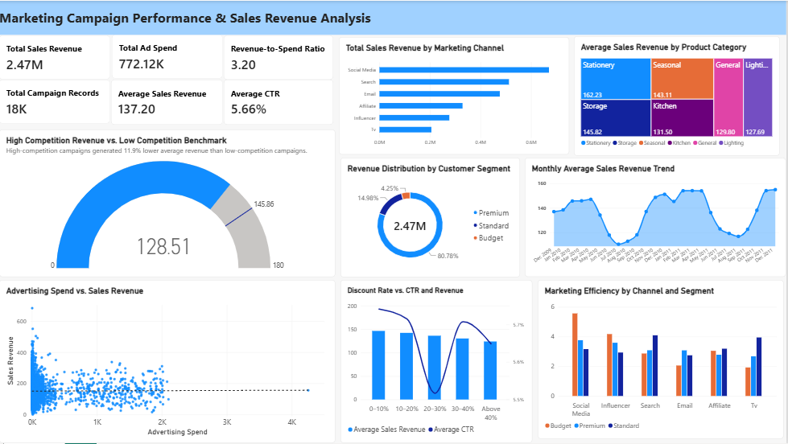

# Marketing Campaign Performance & Sales Revenue Analysis

## Overview
This project analyzes 18,000 marketing campaign records to explore sales revenue, advertising efficiency, customer segments, and campaign performance. Python was used for data cleaning and exploratory data analysis (EDA), while Power BI was used to create an interactive dashboard.

## Tools & Technologies
- **Python:** Pandas, NumPy, Matplotlib, Seaborn
- **Power BI:** Interactive visualizations and DAX measures
- **Jupyter Notebook:** Data cleaning, EDA, and business insights

## Results & Business Recommendations
The analysis of 18,000 marketing campaign records identified several factors associated with sales revenue and campaign performance. Social Media generated the highest total revenue and achieved the strongest overall revenue-to-ad-spend ratio (3.70), while Influencer campaigns recorded the highest average revenue per campaign record. Stationery was the highest-performing product category in terms of average revenue. Additionally, sales performance showed seasonal peaks around October and November, while higher discount rates and greater competition were associated with lower average sales revenue.

Based on these findings, the following business recommendations are proposed:

1. **Optimize marketing budget allocation:** Consider increasing investment in high-performing channels such as Social Media, while monitoring revenue-to-spend ratios to evaluate efficiency.
2. **Prioritize high-performing products:** Develop targeted marketing campaigns for product categories such as Stationery to capitalize on their stronger average revenue.
3. **Plan for seasonal demand:** Prepare marketing campaigns ahead of October and November to take advantage of periods associated with stronger sales performance.
4. **Review discount strategies:** Evaluate whether larger discounts generate sufficient additional demand, as higher discount rates were associated with lower average revenue.
5. **Consider market competition:** Adjust campaign strategies based on competitive intensity, since high-competition campaigns recorded approximately 11.9% lower average revenue than low-competition campaigns.

## Power BI Dashboard
The dashboard presents marketing KPIs, revenue trends, channel and customer segment performance, advertising efficiency, and the relationships between campaign characteristics and sales revenue.

## Project Files
- `notebooks/Marketing_Campaign_EDA.ipynb` — Python data cleaning and exploratory analysis
- `dashboard/Marketing_Campaign_Dashboard.pbix` — Power BI report
- `data/marketing_campaign_cleaned.csv` — Cleaned dataset used for analysis and visualization

## Next Steps
1. **Predict Sales Revenue:** Develop machine learning models to forecast campaign revenue.
2. **Optimize Marketing Strategies:** Explore budget allocation strategies to improve campaign efficiency.
3. **Expand the Analysis:** Include additional campaign data to improve insights and predictions.
